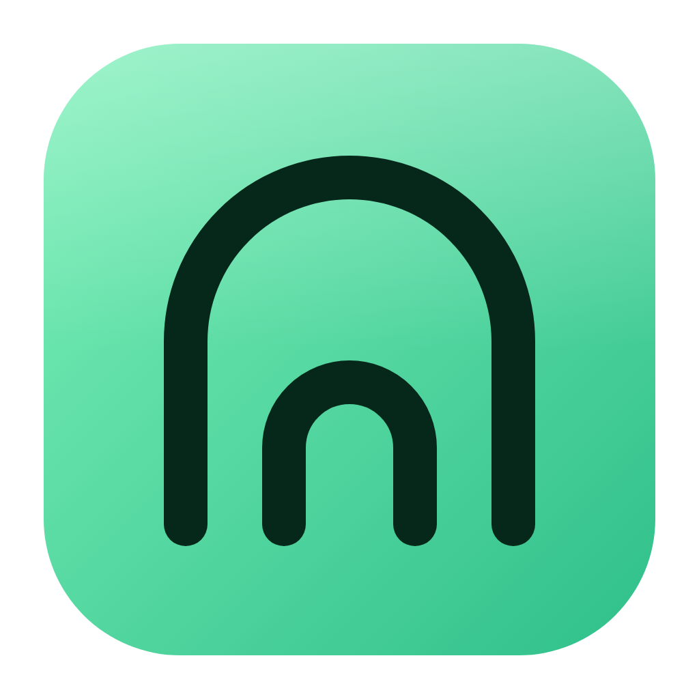
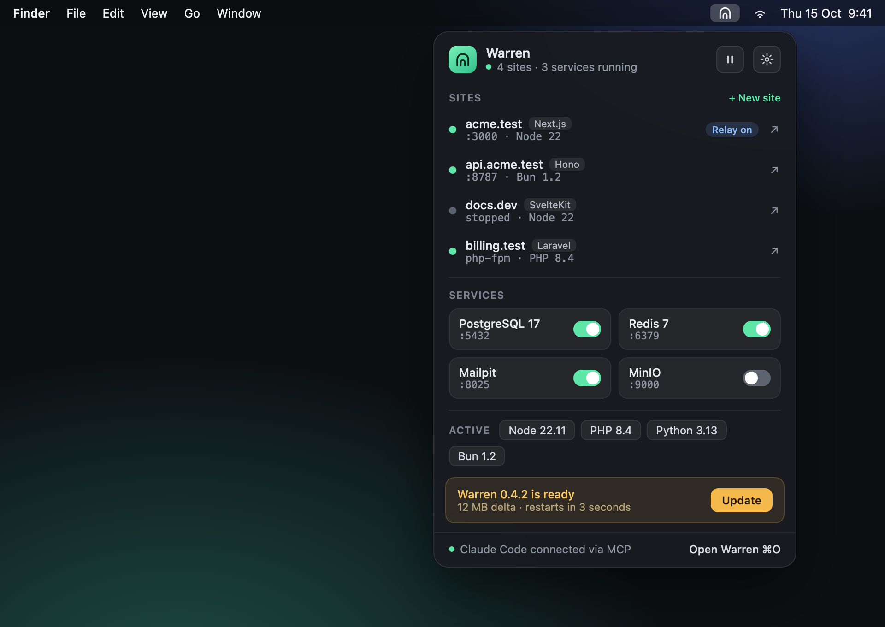
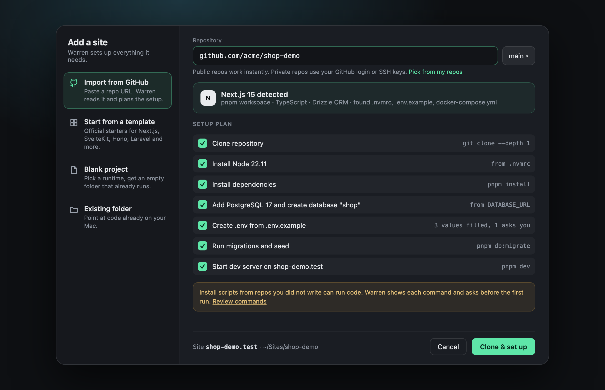
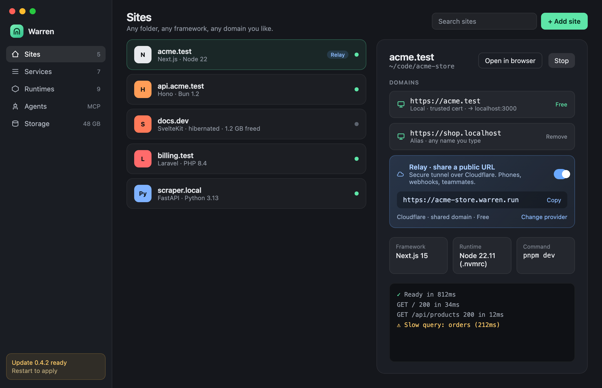
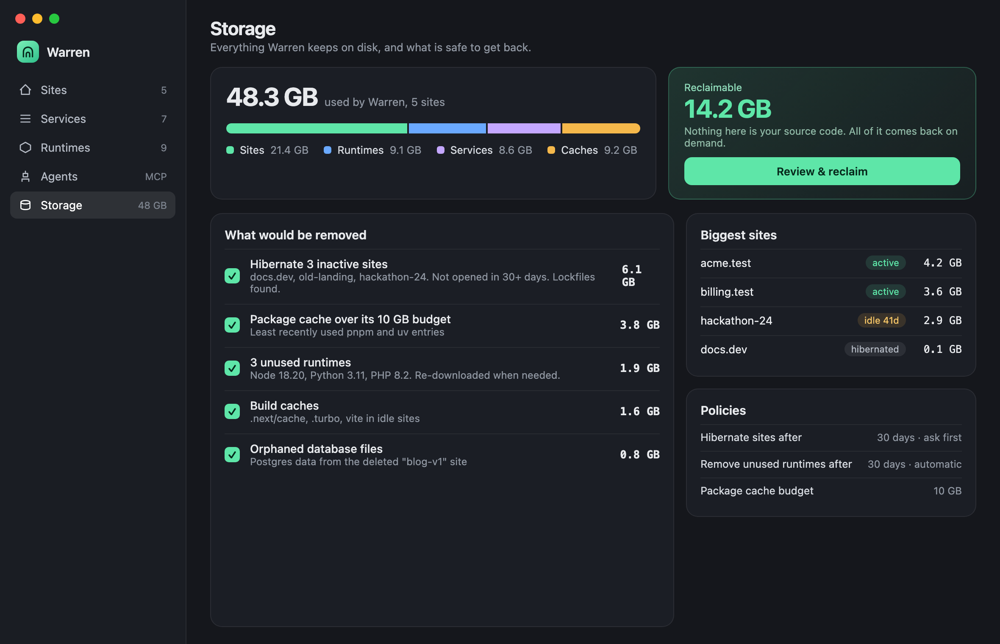
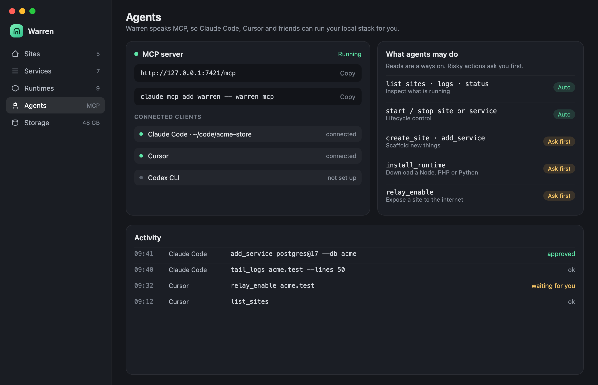

<p align="center">
  
</p>

<h1 align="center">Warren</h1>

<p align="center">
  A light, native macOS menu bar app that runs your local web projects.<br>
  Any framework, any local domain, one-click databases, shareable links, and an MCP server for your agents.
</p>

<p align="center">
  
</p>

<p align="center">
  
  
  <br>
  
  
</p>

> **Status: pre-release.** The screenshots are design mockups with demo data (see [`design/`](design)), not the running app. Nothing is downloadable yet. What exists today is the repo scaffold and the plan in [`specs/ROADMAP.md`](specs/ROADMAP.md).

## For agents

If you are an AI agent working in or with this repo, read [`AGENTS.md`](AGENTS.md) first. The short version:

```sh
git clone https://github.com/kalahroudi/warren && cd warren
brew install just && just setup   # Xcode command line tools, SwiftLint, SwiftFormat
just check                        # format, lint, license headers, build, tests
```

- **Source of truth:** [`specs/`](specs). One spec is one pull request. Start at [`specs/ROADMAP.md`](specs/ROADMAP.md) and [`specs/000-process.md`](specs/000-process.md).
- **Do not invent behavior.** If a spec does not cover it, propose a spec change first.
- **Every commit needs a DCO sign-off** (`git commit -s`), and every Swift or shell file needs an SPDX header.
- **Using Warren as an agent** (MCP server, specs 020 to 022) is planned, not built. When it ships, setup will be `claude mcp add warren -- warren mcp`. Do not rely on it yet.

## Install

Warren is not released yet, so for now you build it from source (macOS 14 or newer, Xcode command line tools):

```sh
git clone https://github.com/kalahroudi/warren && cd warren
brew install just
just setup
just dev      # builds with swiftc alone and launches Warren.app (menu bar icon appears)
```

Planned, once spec 003 ships: a signed and notarized `.dmg` on GitHub Releases, `brew install --cask warren`, and silent delta auto-updates.

## What Warren will do

| | |
|---|---|
| **Add a site four ways** | Import from GitHub, start from a template (Next.js, SvelteKit, Hono, Laravel and more), blank project, or an existing folder. Warren reads the repo, builds a setup plan, and installs the runtimes and services it needs. |
| **Custom local domains** | `acme.test`, `shop.localhost`, or any name you choose, with a trusted certificate. |
| **Native services** | PostgreSQL, MySQL, Redis, Mailpit, MinIO and more as native binaries. An optional container driver covers the rest. |
| **Database browser** | Browse tables, run queries, edit rows and change schemas for Postgres, MySQL and more, with connections created automatically from your sites. |
| **Runtimes** | Node, Bun, PHP, Python and others, per site, picked up from `.nvmrc`, `.php-version` and friends. |
| **Share a link** | Tailscale (free) or Cloudflare (free shared domain, paid custom domain). Run the Relay server yourself or use the hosted one. |
| **Storage that cleans up** | Shared caches, unused-runtime cleanup and site hibernation, so dependencies do not pile up. |
| **Agents** | An MCP server so Claude Code, Cursor and others can run your local stack, with approvals for risky actions. |

## Principles

- **Light:** native Swift, small idle footprint.
- **Easy to update:** signed delta updates that never touch your data.
- **Native first:** containers are optional.
- **Disposable dependencies:** anything regenerable can be reclaimed and restored from your lockfile.
- **Open source:** the app, service catalog and Relay server are all open. A hosted Relay exists for people who would rather not run their own.

## Contribute

Read [`CONTRIBUTING.md`](CONTRIBUTING.md). In short: pick a spec, open a PR with the spec text, implement against its acceptance criteria in the same PR.

## License

The app, core and catalog are [Apache-2.0](LICENSE).
